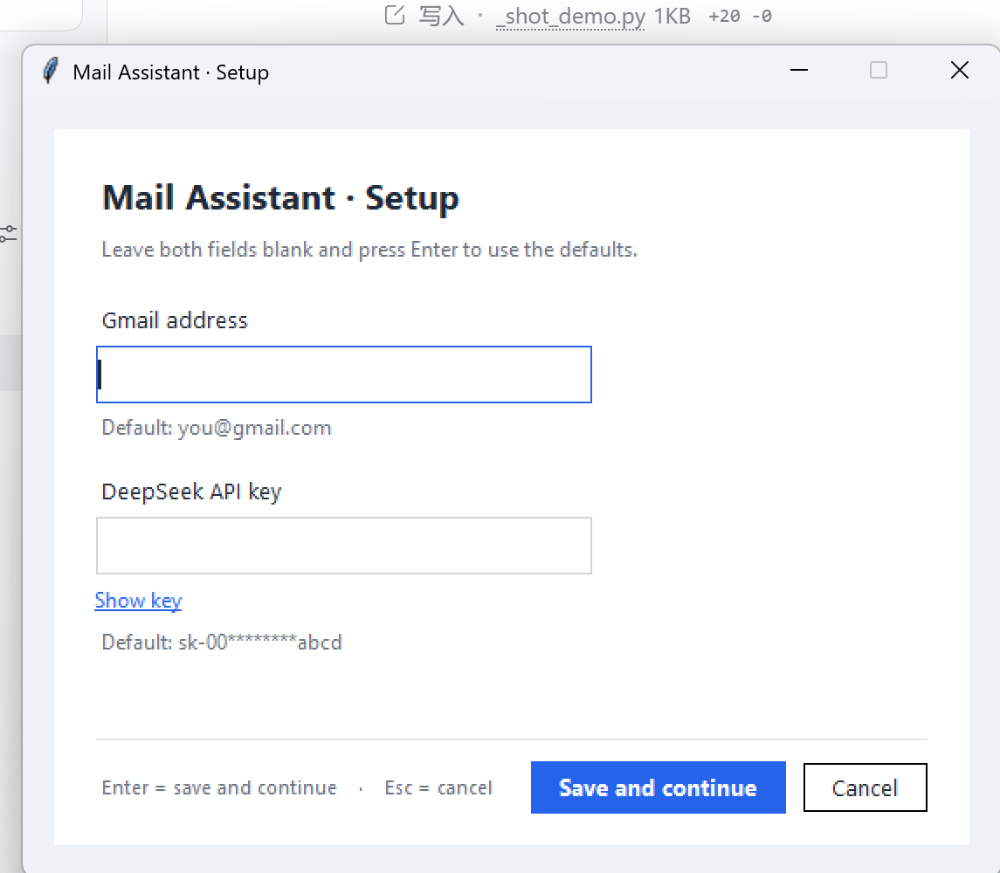

# 邮件优先级助手（AISC 1000A case project）

把 Gmail 收件箱按 P0–P4 五级自动分类并打标签，是 case proposal 里"五级文件夹 + 邮件代理"
的最小可运行内核。

数据流：

```
Gmail API ──拉取/增量同步──> SQLite (mail.db) ──DeepSeek 判定──> Gmail 标签 (P0–P4)
                                    │
                                    └── 结构化字段，后续可接向量库 / chatbot / 日程
```

## 快速开始

```bash
# 1. 依赖
python -m venv .venv
.venv\Scripts\activate          # Windows；Linux/macOS: source .venv/bin/activate
pip install -r requirements.txt

# 2. 配置
copy .env.example .env          # 填入 DEEPSEEK_API_KEY

# 3. 首次授权（会打开浏览器，生成 token.json）
python auth.py

# 4. 跑一轮
python run_pipeline.py --limit 10 -v
```

## 初始配置窗口

双击 `setup.bat`（或 `python setup_gui.py`）打开：



- 两栏都留空、直接回车 = 使用 `.env` 里现有的值（首次即默认邮箱和已配好的 key）。
- 邮箱会做三层检查：① 格式（`@`、local-part、域名、长度、连续点等）；② 是否 Gmail 域名（非 Gmail 会二次确认）；③ 用已授权 token 调 `getProfile` 核对账号——一致给绿字确认，不一致弹窗，**本机没有 token 时明确提示「尚未完成 OAuth 授权」**，不会静默当作已验证。
- API Key 检查 `sk-` 前缀、长度、有无空白；保存时只改 `.env` 里对应的两行，注释和其他配置原样保留。

## 常用命令

| 命令 | 作用 |
|---|---|
| `python run_pipeline.py` | 增量同步 + 分类待处理邮件 |
| `python run_pipeline.py --limit 5 --dry-run` | 只分类、不打标签、不写库（调 rubric 用） |
| `python run_pipeline.py --full` | 忽略 historyId，重扫 inbox |
| `python run_pipeline.py --reset` | 清空分类结果后重新判定 |
| `python run_pipeline.py --non-interactive` | cron / 无桌面环境（禁止弹浏览器） |
| `python -m unittest discover -s tests -v` | 离线测试（不联网、不碰真账号） |

## 模块

| 文件 | 职责 |
|---|---|
| `config.py` | 路径、环境变量、常量；所有路径可用 `AIDE_*` 环境变量覆盖 |
| `utils.py` | 日志、指数退避重试、文本清洗 |
| `auth.py` | OAuth（`gmail.modify`：可读可打标签，不能发信/永久删除） |
| `gmail_reader.py` | 解析正文（HTML→文本）、跳附件、批量拉取、historyId 增量同步 |
| `store.py` | SQLite：旧库自动迁移、UPSERT、失败计数、同步状态 |
| `classify.py` | DeepSeek 分类（工具调用 + 参数降级 + 文本兜底） |
| `label.py` | P0–P4 标签，互斥打标签 |
| `settings.py` | 邮箱/Key 校验、`.env` 原地更新、账号核对 |
| `setup_gui.py` | Tkinter 初始配置窗口（`setup.bat` 启动） |
| `run_pipeline.py` | 命令行入口 |

## 相对初版改了什么

- **配置**：`D:\大学\助手` 硬编码全部移除，改用 `config.py` + `.env`；没有 `.env` 时给出可读报错，而不是在 `OpenAI()` 构造里抛异常。
- **正文**：HTML 邮件转纯文本（跳过 `script/style`、展开链接），不再把 `<style>` 当正文喂模型。
- **标签互斥**：一次 `modify` 同时加目标标签、摘掉其余四个，重跑幂等，不会一封邮件挂多个 P 标签。
- **增量同步**：用 `historyId` 只取新邮件；过期时自动退化为全量扫描。
- **批量拉取**：`batchGet` 把 N 次 HTTP 请求压成 1 次。
- **幂等与可重入**：UPSERT 保留已有分类；失败累计 3 次后跳过；已分类但打标签失败的邮件下轮只补标签、不重复调模型。
- **容错**：网络/限流错误指数退避；单封邮件异常不中断整批；`tool_choice="required"` 不被服务端接受时自动降级。
- **安全**：`.env`、`token.json`、`client_secret*.json`、`mail.db` 已进 `.gitignore`。

## 已知限制

- OAuth 应用若处于 Testing 模式，refresh token 只有 7 天有效期；过期需重新 `python auth.py`。
- `gmail.modify` 才能打标签；若只做只读分析，可把 scope 换成 `gmail.readonly`。
- 尚未实现 proposal 里的 chatbot 前端、向量检索、日程抽取、午间报告——当前只覆盖"收件箱分级"这一层。

## 目录

```
config.py  utils.py  auth.py  gmail_reader.py  store.py  classify.py  label.py
run_pipeline.py  requirements.txt  .env.example  .gitignore  tests/
```
